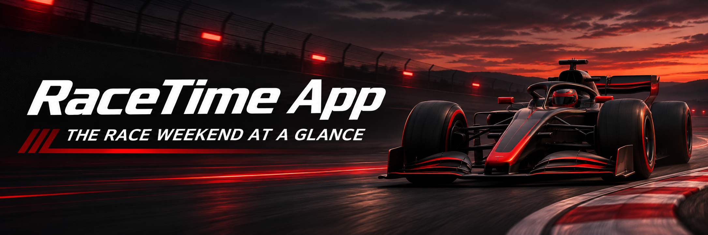
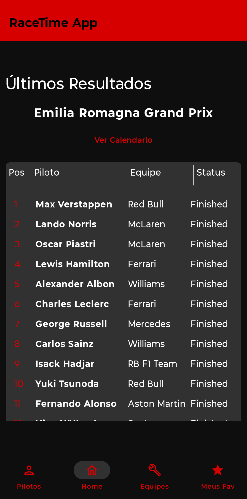
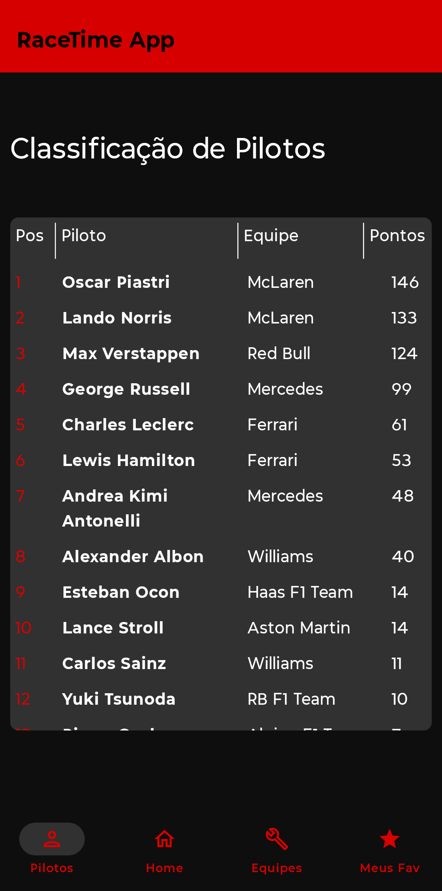
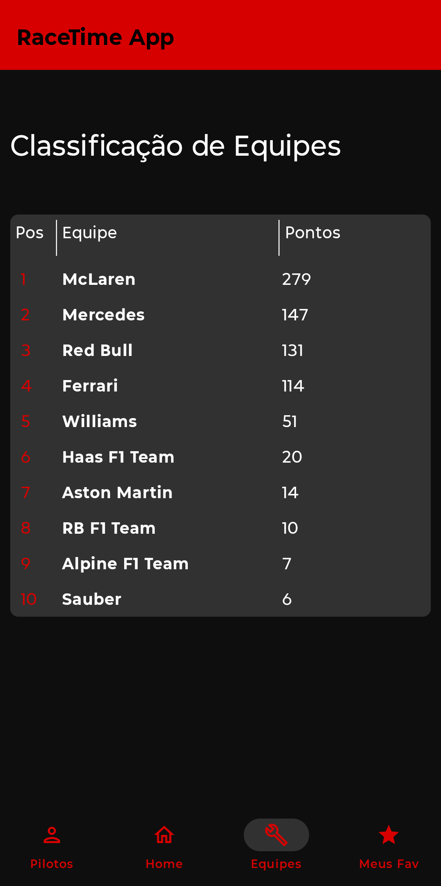
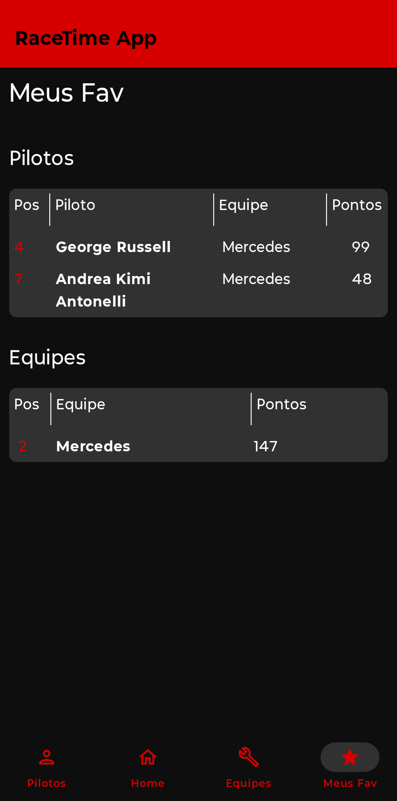
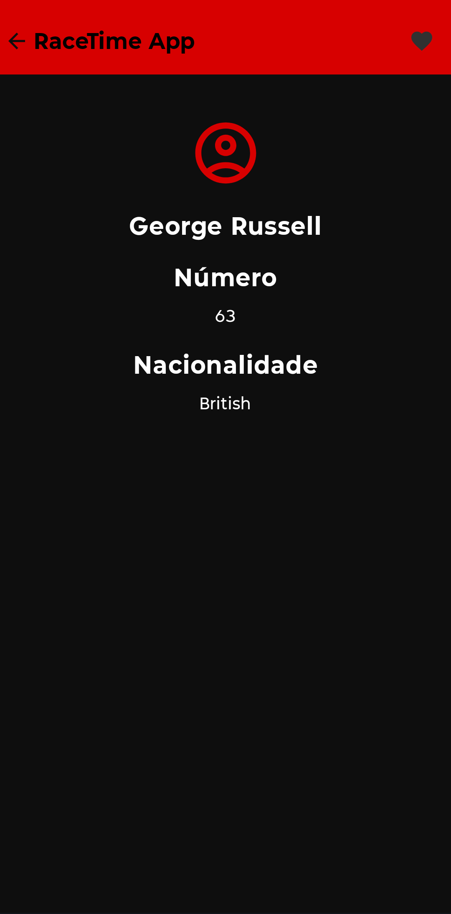
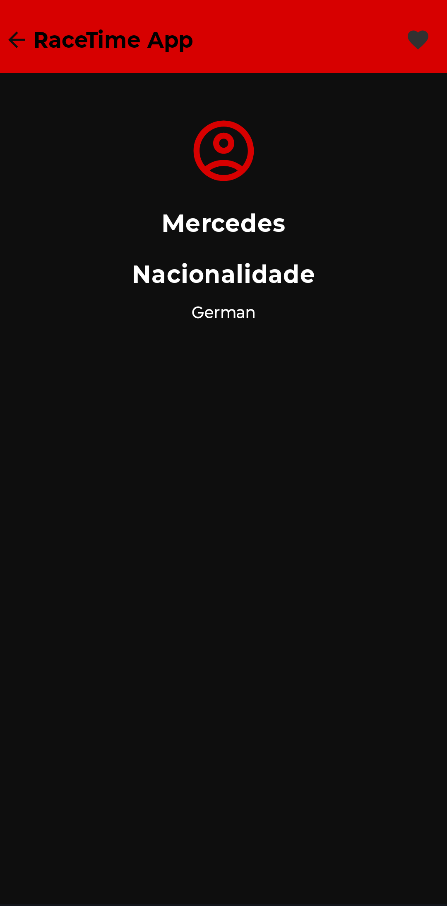

# RaceTime App

An Android companion for Formula 1 fans. Check when the next session starts, catch up on published results, and follow the drivers and teams you care about.

**Android 8.0+ · Kotlin · Jetpack Compose**

[Features](#features) · [Screenshots](#screenshots) · [Getting started](#getting-started) · [Tech stack](#tech-stack)

## Features

| Screen | What you can do |
| --- | --- |
| **Home** | See the countdown to the next session, the latest published result, and a snapshot of the standings. |
| **Calendar** | Browse Grand Prix weekends by season and see session times in your device's time zone. |
| **Grand Prix details** | Check the weekend schedule and see qualifying, Sprint, and race results when available. |
| **Championship** | Track driver and constructor positions, points, and wins. |
| **Favorites** | Keep your favorite drivers and teams within easy reach. |
| **Settings** | Choose which sessions to get local reminders for. Set them for the scheduled start or 15, 30, or 60 minutes beforehand. |

Race statistics include podiums, grid and finishing positions, fastest laps, and lap or pit stop data where available. The app supports English, Brazilian Portuguese, Spanish, French, and Italian.

## Screenshots

These screenshots show the app before the 2.0 redesign.

| Results | Drivers | Constructors |
| :---: | :---: | :---: |
|  |  |  |

| Favorites | Driver profile | Constructor profile |
| :---: | :---: | :---: |
|  |  |  |

## Getting started

1. Clone the repository or extract the project ZIP.
2. Open the project folder in Android Studio, install Android SDK 35, and sync Gradle.
3. Select the `app` run configuration and launch it on an emulator or device running Android 8.0 or newer.

To build a debug APK from the project root:

| Platform | Command |
| --- | --- |
| Windows PowerShell | `.\gradlew.bat :app:assembleDebug` |
| macOS or Linux | `./gradlew :app:assembleDebug` |

## Tech stack

| Area | Tools |
| --- | --- |
| **UI and navigation** | Jetpack Compose, Material 3, Navigation Compose |
| **Architecture and state** | Kotlin, MVVM, Coroutines, StateFlow, Koin |
| **Networking and local storage** | Ktor, Kotlin Serialization, SharedPreferences |
| **Scheduled reminders** | AlarmManager, WorkManager |

See the [redesign notes](ALTERACOES_HOME.md) and [technical documentation](docs/) for implementation details and validation status.

## Data and attribution

Schedules, standings, and published results come from the [Jolpica F1 API](https://github.com/jolpica/jolpica-f1). Results and statistics depend on the source's coverage and publication schedule.

RaceTime App is an independent fan project with no affiliation with Formula 1, the FIA, or any team. Third-party marks belong to their respective owners.
